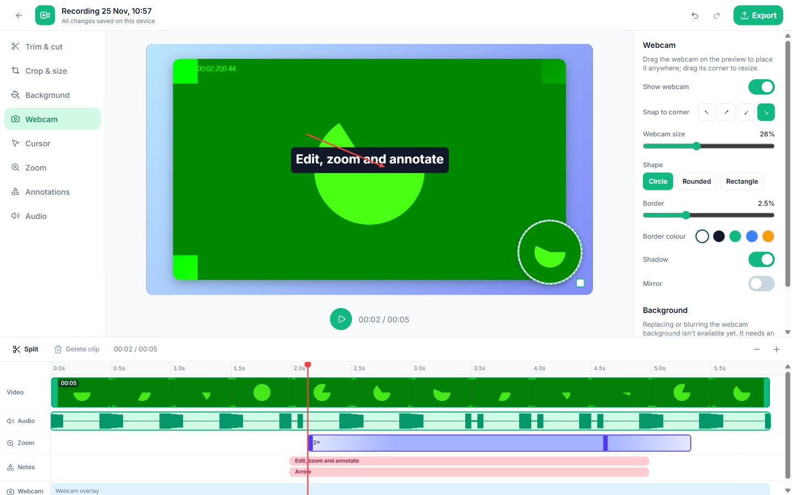
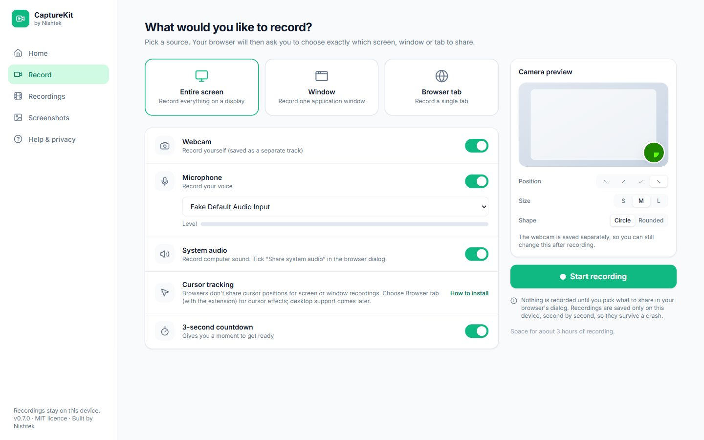
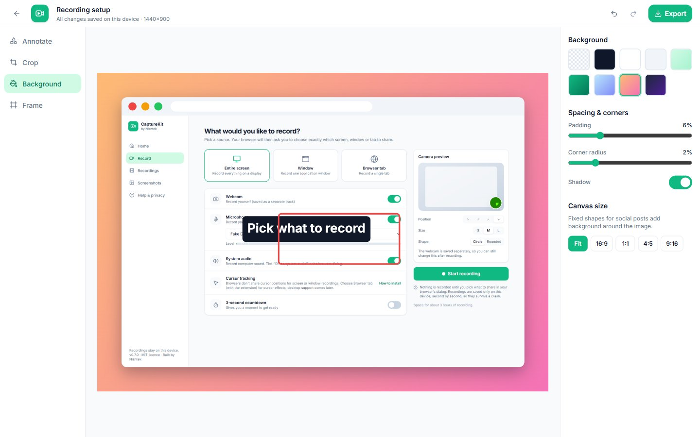

# CaptureKit by Nishtek

**A free, open-source screen recorder, video editor and screenshot editor that runs in your browser.**
Record your screen with your webcam and voice, add smart zoom and cursor effects, annotate, and export.
No account, no uploads, no subscription: everything stays on your device.

**Try it:** [nishtek.in/capturekit](https://nishtek.in/capturekit/) (Chrome or Edge on a desktop computer)



> **Status: v0.8 (release candidate).** Everything below works and is covered by automated browser tests in
> Chrome and Edge. Version 1.0 follows once the [manual release checklist](docs/TESTING.md#manual-release-checklist)
> has been run on real hardware. (Screenshots show Chrome's built-in test video.)

## Features

**Record**
- Entire screen, an application window or a browser tab, with **webcam** (saved as its own track) and **microphone**
- Tab audio and, on Windows/ChromeOS, system audio
- Pause, resume, countdown, mic mute, screenshots while recording, keyboard shortcuts
- Floating pop-out controls (Chrome/Edge)
- **Crash-safe:** saved second by second, and interrupted recordings can be recovered
- Storage checks: warns early, stops and saves before space runs out

**Edit video**
- Trim, split and delete with a filmstrip, waveform and multi-lane timeline; undo/redo; auto-save
- Crop; 16:9, 9:16, 1:1, 4:5; backgrounds, padding, rounded corners, shadow
- Webcam overlay anywhere: circle / rounded / rectangle, border, shadow, mirror
- **Smart zoom:** automatic zoom around clicks that follows the cursor, plus manual zooms
- **Cursor effects:** cursor, smoothing, highlight, click ripple (via the optional extension)
- **Annotations:** text, arrows, shapes, highlighter and **blur** for sensitive info
- Export **WebM** or **MP4** (where the browser can encode it) at 720p, 1080p or the original size

**Edit screenshots**
- Import (file, drag-and-drop, paste), capture, or open a screenshot from a recording
- Annotate, blur, crop, backgrounds, browser/window/device frames, social canvas sizes
- Export **PNG, JPG or WebP**, or copy to the clipboard

<p>
  
  
</p>

## Privacy

- Recording, editing and exporting all happen **in your browser**. Nothing is uploaded and there are no analytics.
- A Content-Security-Policy makes the browser **block any request to another site**, and an automated test checks this.
- Camera, microphone and screen are only requested when you turn them on or start recording.
- Data lives in your browser's storage on this device. Clearing site data deletes it, so download what you want to keep.

## Browser support

| | Chrome / Edge | Firefox | Safari |
|---|---|---|---|
| Screen / window / tab | ✅ | screen & window | screen & window |
| Tab audio | ✅ | ❌ | ❌ |
| Whole-screen system audio | Windows & ChromeOS | ❌ | ❌ |
| Mic & webcam | ✅ | ✅ | ✅ |
| Pop-out controls | ✅ | — | — |
| Cursor extension | ✅ (116+) | — | — |
| Video export | WebM & MP4 | WebM (untested) | MP4 (untested) |

Mobile browsers can't record the screen, and no browser can capture audio from a single window.
Automated tests run in Chrome and Edge; Firefox and Safari still need testing.

### Cursor tracking extension (optional)

Browsers don't tell web pages where your cursor is. The small extension in [`extension/`](extension/README.md)
records cursor moves and clicks in the **browser tab you record**, which powers cursor effects and automatic zoom.
Screen and window recordings will need a planned desktop companion for this.

## Run it locally

Requires Node.js 20 or later.

```bash
npm install
npm run dev        # development: http://localhost:3000
npm run build      # static site → out/
npm start          # serve the built site on http://localhost:3000
```

Screen capture only works on `https://` or `localhost`. Deploying is just hosting `out/`: see
[docs/DEPLOYMENT.md](docs/DEPLOYMENT.md) (a GitHub Pages workflow is included).

## Documentation

| | |
|---|---|
| [User guide](docs/USER_GUIDE.md) | How to record, edit and export |
| [Architecture](ARCHITECTURE.md) | How it works and why; browser limitations |
| [Project plan](PROJECT_PLAN.md) | Roadmap and verified status of every feature |
| [Testing](docs/TESTING.md) | Automated tests and the manual release checklist |
| [Deployment](docs/DEPLOYMENT.md) · [Release](docs/RELEASE.md) | Hosting and publishing |
| [Contributing](CONTRIBUTING.md) · [Code of conduct](CODE_OF_CONDUCT.md) · [Security](SECURITY.md) · [Changelog](CHANGELOG.md) | |

## Tech

Next.js (static export), React, TypeScript, Tailwind CSS and Lucide icons. Recording uses `getDisplayMedia`,
`getUserMedia`, Web Audio and `MediaRecorder`. Editing renders on a canvas (the same renderer for preview and
export), and storage is IndexedDB. Runtime dependencies are only Next.js, React and Lucide.

## Licence

[MIT](LICENSE) © Nishtek. Built by Nishtek.
